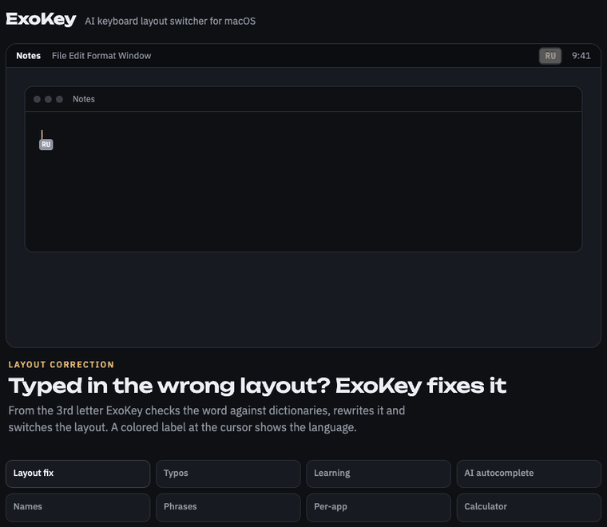
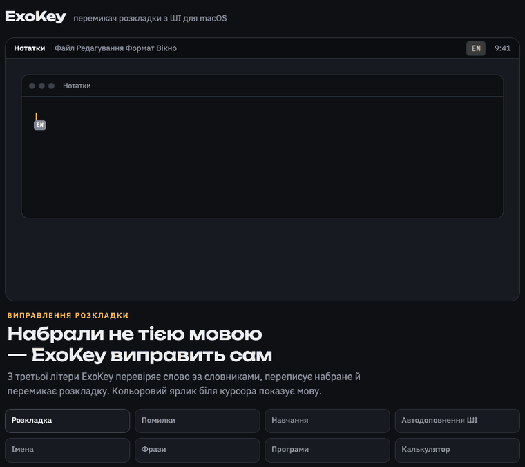

# ExoKey

**English** · [Українська](#українська)

ExoKey fixes text typed in the wrong keyboard layout on macOS (English, Russian, Ukrainian) and suggests the next words with a local AI model. Everything runs on your Mac; no text leaves your computer.

**[⬇ Download the latest release](https://github.com/jandiradmin/ExoKey/releases/latest)** · macOS 13+ · Apple Silicon



## Features

- **Layout correction:** `ghbdtn` becomes `привет` as you type, with the layout switched to match. ExoKey checks words from the 2nd or 3rd letter against dictionaries of ~4.8M word forms, and checks the whole word again when you finish it.
- **Typo correction:** when a word isn't in the dictionary, ExoKey finds the closest one (a missing, extra, wrong or swapped letter): `хорактестиски` → `характеристики`, `teh` → `the`. The fix appears under the word and Tab applies it; ⌃⌥C fixes the last word on demand, and ⌃⌥Z brings yours back. Auto-replace is an option.
- **Names:** suggestions capitalize names and places (`мар` + Tab → `Марина`). ExoKey also learns how you write them; capitalizing names while typing is an option.
- **Layout label at the cursor:** a small colored label (EN blue, UK yellow, RU purple) appears under the cursor when the layout changes.
- **Any layouts:** ABC, US, Russian, Russian – PC, Ukrainian and others. ExoKey reads the key mapping from macOS and stays idle in other layouts, such as German.
- **Learning:**
  - Corrections you undo become exceptions.
  - New words, names and abbreviations you type repeatedly go to your dictionary.
  - Words in ALL CAPS are never changed.
- **AI autocomplete (optional):**
  - Gray inline suggestions after the cursor.
  - Uses the text of the current window (chat, email, page) as context.
  - Only confident parts of a suggestion are shown.
  - Runs a local Qwen3-4B model through llama.cpp. You download it from Settings: 2.5 GB fast or 4.3 GB accurate.
  - A light mode completes words from the dictionaries only, without the model.
- **Phrases:** saved phrases and banned suggestions. ExoKey also learns from suggestions you accept or reject.
- **Per-app layouts:** pick an app, and ExoKey switches to its layout when you switch to the app. You can set it quickly from the menu bar.
- **Calculator:** type `2+2=` and ExoKey appends `4`. Supports `+ - * / ^ %` and parentheses.
- **Dictionary editor:** words, exceptions, rules, candidates, phrases and banned suggestions, with import, export and backup.
- **Passwords are never touched:** ExoKey skips password fields, both the protected ones and fields labeled password, PIN or code. Words with digits are never corrected, so `ghbdtn123` stays as typed. For a one-off case, pause ExoKey with ⌃⌥P.
- **Exclusions:** per-app exclusions, separately for layout correction and for autocomplete. Terminals and code editors are excluded by default.
- **Interface:** English, Ukrainian, Russian, dark theme.

## Hotkeys

All hotkeys can be changed in Settings.

| Action | Default |
|---|---|
| Undo last correction | ⌃⌥Z |
| Fix typo in last word | ⌃⌥C |
| Convert last word to another layout | ⌃⌥X |
| Pause / resume ExoKey | ⌃⌥P |
| Accept next word of a suggestion | Tab |
| Accept whole suggestion | ⇧Tab |
| Hide suggestion | Esc |
| Undo inserted suggestion | ⌃⌥⌫ |
| Autocomplete on / off | ⌃⌥A |

## Install

1. Download `ExoKey-x.y.z.zip` from [Releases](https://github.com/jandiradmin/ExoKey/releases), unzip it and move `ExoKey.app` to **Applications**.
2. Preview builds are not notarized yet. On first launch, go to **System Settings → Privacy & Security** and click **Open Anyway**.
3. Allow ExoKey in **Accessibility** and **Input Monitoring**.
4. ExoKey lives in the menu bar (`EN` / `RU` / `UK`). Settings and the dictionary editor are in its menu. Launching ExoKey again also opens Settings.

## Privacy

- Typed text is never stored or sent anywhere.
- Window text used as context for suggestions is processed in memory only.
- Only the words, phrases and rules you add, or ExoKey learns, are saved, locally in `~/Library/Application Support/ExoKey/`.
- The diagnostic log (`~/Library/Logs/ExoKey.log`) contains no typed text.

## Build from source

```
xcode-select --install
git clone git@github.com:jandiradmin/ExoKey.git && cd ExoKey
scripts/fetch_dicts.sh          # downloads word lists, builds data/dict/*.exd
scripts/make_dev_cert.sh        # stable local signing, so permissions survive rebuilds
scripts/build_app.sh --install  # builds ExoKey.app and installs it to /Applications
```

The build uses Swift Package Manager with the Command Line Tools, so Xcode is not required. A release is published with `scripts/release.sh <version>`.

## Credits & licenses

- ExoKey code: MIT.
- Word frequencies: [hermitdave/FrequencyWords](https://github.com/hermitdave/FrequencyWords), CC BY-SA 4.0.
- Word forms: [LibreOffice dictionaries](https://github.com/LibreOffice/dictionaries) (en_US, ru_RU, uk_UA), under their respective licenses.
- AI: [llama.cpp](https://github.com/ggml-org/llama.cpp) (MIT) and [Qwen3-4B-Instruct-2507](https://huggingface.co/Qwen/Qwen3-4B-Instruct-2507) (Apache 2.0). The model is downloaded on demand and is not bundled.

If ExoKey is useful to you, a donation or a ⭐ is appreciated.

---

## Українська

ExoKey виправляє текст, набраний не в тій розкладці на macOS (англійська, російська, українська), і підказує наступні слова за допомогою локальної моделі ШІ. Усе працює на вашому Mac, текст нікуди не надсилається.

**[⬇ Завантажити останню версію](https://github.com/jandiradmin/ExoKey/releases/latest)** · macOS 13+ · Apple Silicon



### Можливості

- **Виправлення розкладки:** `ghbdsn` перетворюється на `привіт` прямо під час набору, і розкладка перемикається. ExoKey перевіряє слово з 2–3-ї літери за словниками на ~4,8 млн словоформ і ще раз, коли слово завершено.
- **Виправлення помилок:** якщо слова немає в словнику, ExoKey шукає найближче (пропущена, зайва, хибна чи переставлена літера): `хорактестиски` → `характеристики`, `teh` → `the`. Підказка з’являється під словом, Tab застосовує; ⌃⌥C виправляє останнє слово на вимогу, ⌃⌥Z повертає ваш варіант. Автозаміна вмикається окремо.
- **Імена:** у підказках імена й назви пишуться з великої літери (`мар` + Tab → `Марина`). ExoKey також запам’ятовує, як пишете їх ви; виправлення регістру під час набору вмикається окремо.
- **Ярлик розкладки біля курсора:** невеликий кольоровий ярлик (EN синій, UK жовтий, RU фіолетовий) з’являється під курсором, коли змінюється розкладка.
- **Будь-які розкладки:** ABC, US, російська, українська та інші. ExoKey бере відповідність клавіш із macOS і нічого не робить в інших розкладках, наприклад у німецькій.
- **Навчання:**
  - Скасовані виправлення стають винятками.
  - Нові слова, імена й скорочення, які ви повторюєте, потрапляють до словника.
  - Слова ВЕЛИКИМИ літерами ніколи не змінюються.
- **Автодоповнення ШІ (за бажанням):**
  - Сірі підказки одразу після курсора.
  - Враховують текст вікна: листування, лист, сторінку.
  - Показується лише та частина підказки, у якій модель упевнена.
  - Працює локальна модель Qwen3-4B через llama.cpp. Її завантажують із Налаштувань: 2,5 ГБ швидка або 4,3 ГБ точна.
  - Полегшений режим доповнює слова лише за словником, без моделі.
- **Фрази:** збережені фрази та заборонені підказки. ExoKey також навчається на підказках, які ви прийняли або відхилили.
- **Розкладка для програм:** оберіть програму, і під час переходу в неї ExoKey вмикає її розкладку. Швидко налаштовується з меню.
- **Калькулятор:** наберіть `2+2=`, і ExoKey допише `4`.
- **Редактор словника:** слова, винятки, правила, кандидати, фрази й заборонені підказки, з імпортом, експортом і резервною копією.
- **Паролі не чіпаються:** ExoKey пропускає поля паролів, і захищені, і ті, що підписані як пароль, PIN чи код. Слова з цифрами не виправляються, тож `ghbdtn123` лишиться як є. Для разового випадку призупиніть ExoKey через ⌃⌥P.
- **Винятки:** окремо для виправлення розкладки й для автодоповнення. Термінали й редактори коду вимкнено за замовчуванням.
- **Інтерфейс:** українська, англійська, російська, темна тема.

### Гарячі клавіші

Усі гарячі клавіші можна змінити в Налаштуваннях.

| Дія | За замовчуванням |
|---|---|
| Скасувати останнє виправлення | ⌃⌥Z |
| Виправити помилку в останньому слові | ⌃⌥C |
| Перетворити останнє слово в іншу розкладку | ⌃⌥X |
| Призупинити / увімкнути ExoKey | ⌃⌥P |
| Прийняти наступне слово підказки | Tab |
| Прийняти всю підказку | ⇧Tab |
| Сховати підказку | Esc |
| Скасувати вставлену підказку | ⌃⌥⌫ |
| Увімкнути / вимкнути автодоповнення | ⌃⌥A |

### Встановлення

1. Завантажте `ExoKey-x.y.z.zip` з [Releases](https://github.com/jandiradmin/ExoKey/releases), розпакуйте й перенесіть `ExoKey.app` до **Програм**.
2. Попередні версії ще не нотаризовані. Під час першого запуску відкрийте **Системні параметри → Приватність і безпека** і натисніть **Усе одно відкрити**.
3. Дозвольте ExoKey доступ у розділах **Доступність** і **Моніторинг введення**.
4. ExoKey живе в рядку меню (`EN` / `RU` / `UK`). Налаштування й словник відкриваються з його меню, а також при повторному запуску програми.

### Приватність

- Набраний текст не зберігається й нікуди не надсилається.
- Текст вікна для підказок обробляється лише в пам’яті.
- Зберігаються тільки слова, фрази й правила, які ви додали або яких ExoKey навчився. Вони лежать локально в `~/Library/Application Support/ExoKey/`.

### Збирання з коду

Інструкцію наведено вище, у розділі [Build from source](#build-from-source).

### Ліцензії

Код ExoKey поширюється під ліцензією MIT. Ліцензії словників, llama.cpp і моделі Qwen3 наведено вище, у розділі [Credits & licenses](#credits--licenses).
